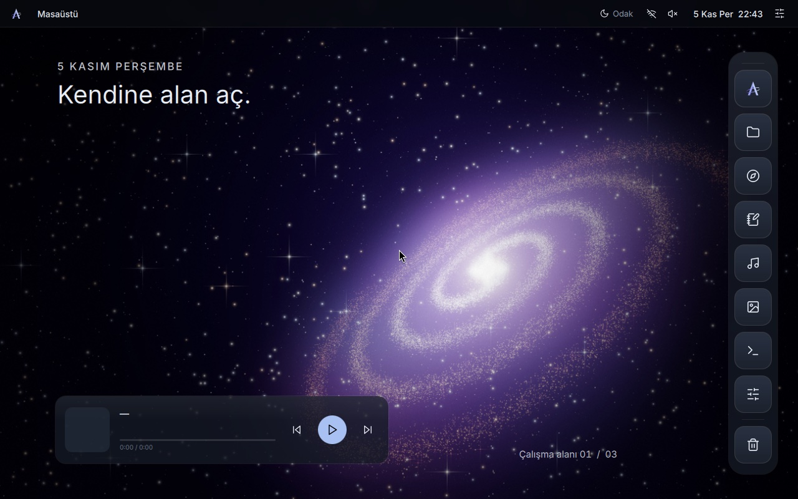
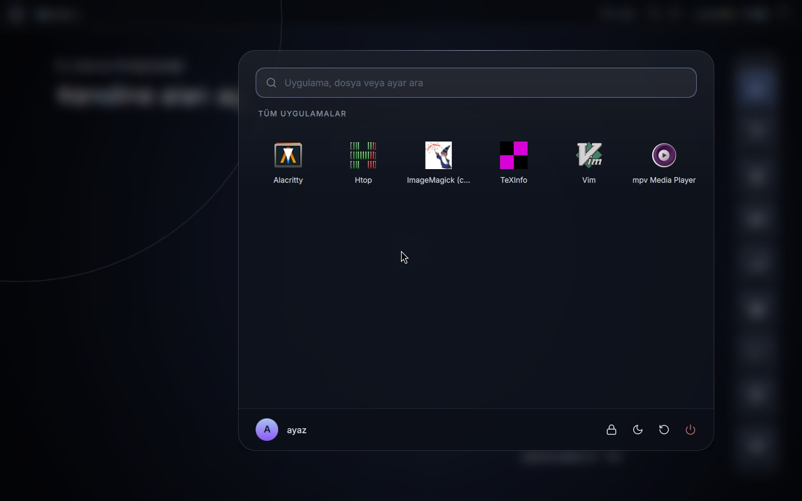
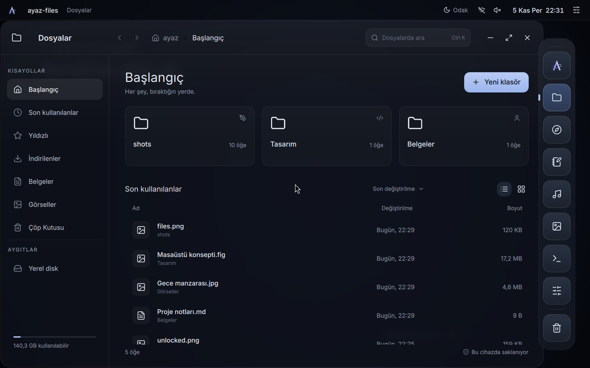
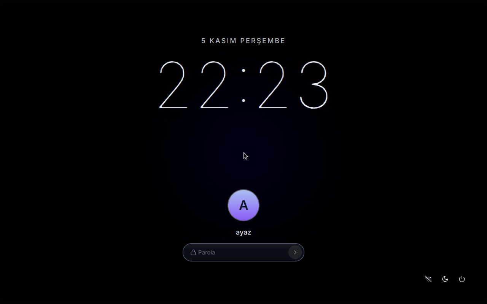
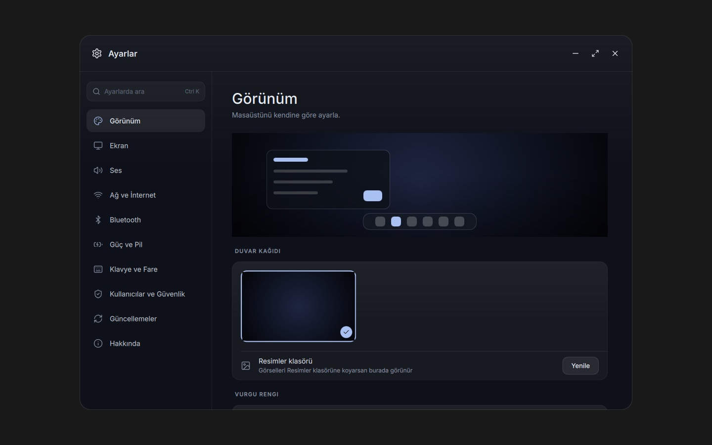
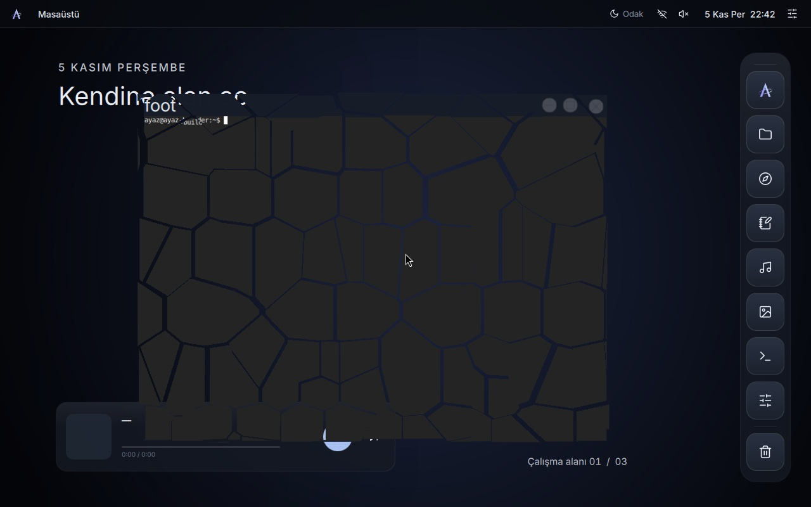
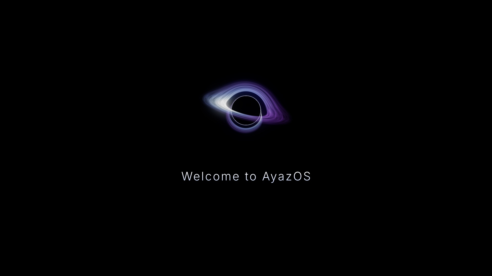

# AyazOS

Ubuntu 26.04 LTS üzerine kurulu, GNOME kullanmayan, hızlı ve şık bir masaüstü Linux dağıtımı.
Hedef donanım: normal seviye Intel/AMD 64 bit bilgisayarlar.



## Öne çıkanlar
- **Kendi masaüstü kabuğu**: Wayfire bileşik yöneticisi üzerinde Quickshell/QML ile yazılmış üst çubuk,
  sağ dock, su damlası efektiyle açılan başlat menüsü, kontrol merkezi, bildirimler ve kilit ekranı.
- **Pencere efektleri**: sürüklerken dalgalanma, küçültünce dock'a akma (`compositor/ayaz-effects`),
  kapatınca camın kırılıp dağılması.
- **Sistem uygulamaları**: Dosyalar, Ayarlar, Yazılım Merkezi, Sistem Doktoru, Müzik, Galeri.
  Hepsi tek bir Qt taşıyıcısı (`ayaz-app`) ve ortak tasarım modülü (`AyazOS.UI`) kullanır.
- **Windows programları**: `.exe` / `.msi` dosyaları çift tıklayınca Wine ile, her biri kendi önekinde açılır.
- **Oyun**: Steam, GameMode, MangoHud ve arka planda otomatik ekran kartı sürücüsü kurulumu.
- **Güncellemeler**: imzalı AyazOS APT deposu, arka planda güvenlik güncellemeleri, Firefox Mozilla deposundan (snap yok).
- **Kurulum**: Calamares ile birkaç adımda; açılışta kara delik animasyonu (Plymouth).

| | |
|---|---|
|  |  |
|  |  |
|  |  |

## Mimari
| Katman | Bileşen | Dizin |
|---|---|---|
| Bileşik yönetici | Wayfire 0.10 + eklentiler | `compositor/`, `session/wayfire.ini` |
| Masaüstü kabuğu | Quickshell (QML) | `shell/` |
| Uygulamalar | Qt 6 + QML | `apps/` |
| Giriş ekranı | greetd + QML greeter | `shell/greeter.qml` |
| Marka | logo, duvar kağıtları, Plymouth | `branding/` |
| Paketler | Debian paketleri | `packaging/` |
| ISO | debootstrap, casper, Calamares, GRUB | `distro/` |
| Güncelleme deposu | reprepro + GPG | `repo/` |

Ayrıntılar: [docs/SPEC.md](docs/SPEC.md), [docs/ARCHITECTURE.md](docs/ARCHITECTURE.md), [docs/APP-GUIDE.md](docs/APP-GUIDE.md)

## Derleme
Derleme bir Ubuntu 26.04 sanal makinesinde yapılır (`scripts/`):
```sh
sudo distro/build-debs.sh                 # amd64 paketleri -> /srv/debs
repo/publish.sh /srv/debs /srv/repo       # imzalı APT deposu
sudo distro/build-iso.sh /srv/repo ayazos.iso
```

## Durum
Erken geliştirme aşamasında. Ekran görüntüleri sanal makinede yazılım tabanlı çizimle alınmıştır.
